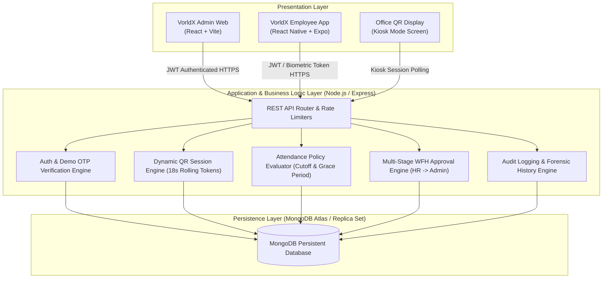

# VORLDX INDUSTRIES PRIVATE LIMITED
**CIN:** U62099UP2026PTC245598  
**Headquarters:** Lucknow, Uttar Pradesh, India  
**Official Contact:** hello@vorldx.com  
**Project:** VorldX Employee Attendance System (Full-Stack Enterprise Solution)

---

## 1. Project Overview & Objectives

The **VorldX Employee Attendance System** is an enterprise workforce governance solution engineered for modern businesses. It bridges administrative workforce management with a mobile-first employee experience through two coordinated applications and a supporting office reception kiosk:

1. **VorldX Employee Website (HR/Admin Console):** Central web application for administrators and HR teams to oversee workforce telemetry, enforce attendance schedules, manage employee directories, configure dynamic QR rotation, review multi-stage WFH and leave requests, execute audited attendance corrections, and inspect departmental analytics.
2. **VorldX Employee Mobile App:** Cross-platform mobile client for employee account onboarding, demo verification with simulated OTP, camera-based dynamic QR check-in and check-out, personal attendance records, live shift telemetry, and WFH/leave applications.
3. **Office QR Display (Reception / Wall Kiosk):** Dedicated office screen component continuously generating 18-second cryptographically rotating QR sessions, featuring laser scan animations, real-time clock, and kiosk mode.

---

## 2. System Architecture & Component Interaction



---

## 3. Database Design & Data Entities

The database layer utilizes Mongoose ODM with strict schema validation, unique indexes, and audit references:

### Main Data Entities

| Entity | Primary Fields | Key Indexes & Constraints |
| :--- | :--- | :--- |
| **User** | `name`, `email`, `passwordHash`, `role` (`SUPER_ADMIN`, `HR_ADMIN`, `EMPLOYEE`), `avatar`, `active` | Unique `email`, Case-insensitive collation |
| **Employee** | `user`, `employeeId`, `name`, `email`, `department`, `designation`, `phone`, `shift`, `active`, `avatar` | Unique `employeeId`, Unique `user` reference |
| **Attendance** | `employee`, `date` (YYYY-MM-DD), `status` (`PRESENT`, `LATE`, `HALF_DAY`, `ABSENT`), `mode` (`OFFICE`, `WFH`), `checkIn`, `checkInMethod`, `checkOut`, `auditHistory` | Compound Unique `(employee, date)` preventing duplicates |
| **WfhRequest** | `employee`, `startDate`, `endDate`, `wfhType` (`STANDARD`, `URGENT`), `reason`, `documentUrl`, `status` (`PENDING`, `HR_APPROVED`, `APPROVED`, `REJECTED`, `CANCELLED`), `hrApprovedBy`, `adminApprovedBy` | Indexed `(startDate, endDate, status)` for 5/day quota check |
| **LeaveRequest** | `employee`, `startDate`, `endDate`, `leaveType` (`CASUAL`, `SICK`, `EARNED`), `reason`, `status`, `decidedBy` | Date-range queries with balance validation |
| **QrSession** | `token`, `officeLocation`, `generatedBy`, `expiresAt`, `used`, `usedBy`, `usedAt` | TTL index on `expiresAt` (18s expiry), Unique `token` |
| **AttendancePolicy** | `officeStartTime` (09:00), `checkInCutoffTime` (09:30), `officeEndTime` (18:00), `maxWfhPerDay` (5), `qrCodeExpirySeconds` (18) | Single active policy document per organization |
| **AuditLog** | `actor`, `action`, `targetType`, `targetId`, `details`, `ipAddress`, `timestamp` | Append-only forensic immutable collection |
| **Notification** | `title`, `message`, `type`, `targetAudience`, `priority`, `readBy`, `createdAt` | Real-time broadcast and personal alert inbox |

---

## 4. Key Application Flows & Demonstration Guide

### 4.1 Demo Account Verification & Simulated OTP Flow
1. **Employee Identification:** Employee opens the mobile app and selects the **Verify & Register (Demo)** tab.
2. **Preset Demo Accounts:** Demo buttons are available for `VX-EMP-001` (Aarav Sharma), `VX-EMP-002` (Priya Patel), or `VX-EMP-003` (Kavita Reddy).
3. **Directory Matching:** Backend validates the ID against corporate directory records.
4. **Simulated OTP Delivery:** Backend generates demo OTP `8426` and renders an instant auto-fill code badge.
5. **OTP Validation:** Mobile app submits the OTP to `/api/auth/verify-demo-otp`.
6. **Password Creation & JWT Issue:** Employee creates a secure password; the backend hashes it with bcrypt (cost factor 12) and returns an active JWT session.

### 4.2 Office Dynamic QR Attendance Flow
1. **Screen QR Generation:** Office QR display requests a rolling token via `/api/qr/session` or `/api/qr/kiosk`.
2. **18-Second Rotation:** The token expires after 18 seconds; a progress bar and laser beam sweep indicate countdown.
3. **Camera Check-In:** Employee taps **Scan Office QR to Check In** on the mobile dashboard. The token is consumed via `/api/attendance/check-in`.
4. **Policy Evaluation:** Server evaluates Indian Standard Time (IST). Check-in before 09:30 AM marks `PRESENT`; check-in after 09:30 AM marks `LATE`.
5. **Camera Check-Out:** Employee taps **Scan Screen QR to Check Out** to verify presence at office close. The server records checkout timestamp via `/api/attendance/check-out`.

### 4.3 Multi-Stage WFH Approval Flow (HR -> Admin)
1. **Application:** Employee views daily availability quota (maximum 5 approved WFH employees per day) and applies for WFH with date, reason, and optional document proof.
2. **HR First Review:** HR Admin logs in to `/approvals` and inspects the request. HR can approve or reject. Approval transitions status to `HR_APPROVED`.
3. **Super Admin Final Confirmation:** Super Admin reviews all `HR_APPROVED` requests. Only requests that passed HR review can receive final approval.
4. **Attendance Unlocking:** Once approved by Super Admin, employee can record remote attendance for the approved dates.

### 4.4 Profile Photo Upload & Admin Inspection
1. **Mobile Upload:** Employee taps profile avatar circle in the mobile app, chooses Camera or Photo Library, and uploads a profile picture.
2. **Storage & Serving:** Image is safely decoded and saved under `backend/uploads/avatars/`.
3. **Admin Visibility:** Profile photos are immediately visible in the Admin Web directory (`/employees`), attendance sheets (`/attendance`), request cards (`/approvals`), and dashboard activity streams.

### 4.5 Role Authorization & HR Admin Provisioning
1. **Super Admin Exclusivity:** Only users with `SUPER_ADMIN` privileges are authorized to create, update, deactivate, or reactivate HR Admin accounts (`/hr-admins`).
2. **Backend Role Guard:** All `/api/hr-admins` routes are protected with `allowRoles("SUPER_ADMIN")`. Calls by HR Admins or Employees are immediately rejected with HTTP `403 Forbidden`.
3. **Frontend Role-Based Access Control:** The HR Admin Management screen and navigation items are solely rendered for Super Admins. Route `/hr-admins` is strictly protected by `ProtectedRoute allowedRoles={["SUPER_ADMIN"]}`.
4. **.env Credential Enforcement:** Super Admin login is strictly governed by the `.env` configuration (`ADMIN_ID`, `ADMIN_PASS`). Only `.env`-specified credentials can authenticate administrative sessions.

---

## 5. Verification & Testing Matrix

| Test Suite | Scope | Result | Status |
| :--- | :--- | :--- | :--- |
| **Test 1** | Database Connection & Connection Pool Health | Connection verified active | PASSED |
| **Test 2** | Asia/Kolkata IST Date & Time Computation | 24-hour timezone format validated | PASSED |
| **Test 3** | Policy Cutoff Evaluator (09:30 AM IST boundary) | Accurate PRESENT vs LATE classification | PASSED |
| **Test 4** | Secure QR Session 18s Expiry & Replay Prevention | Replayed tokens rejected with 400 | PASSED |
| **Test 5** | Duplicate Check-In Compound Index Prevention | Duplicate check-in rejected with 409 | PASSED |
| **Test 6** | Attendance Correction History & Reason Preservation | Audit log records previous and new values | PASSED |
| **Test 7** | WFH Daily Quota Enforcement (Max 5 Approved/Day) | 6th concurrent request blocked | PASSED |
| **Test 8** | JWT Cryptographic Signature & Issuer Validation | Expired/tampered tokens rejected | PASSED |
| **Test 9** | Demo Employee Verification & Simulated OTP Onboarding | Preset lookup and code 8426 verified | PASSED |
| **Test 10** | WFH Multi-Stage Approval Integrity (HR Prerequisite) | Super Admin block without HR approval verified | PASSED |
| **Test 11** | Admin Login Strictly Enforces .env Credentials | Validates .env source of truth | PASSED |
| **Test 12** | Role Permissions: Only Super Admin Can Add HR Admins | Super Admin permitted, HR & Employee blocked | PASSED |
| **Test 13** | Passwordless Mobile Number OTP Login Flow | Accepts registered mobile + code 8426 | PASSED |
| **Test 14** | Real Dynamic SMS OTP Generation & Verification | 4-digit cryptographic OTP generation, storage, and TTL | PASSED |
| **Admin Web Build** | Vite Production Build & Asset Minification | 0 errors (66 kB CSS, 806 kB JS) | PASSED |
| **Employee App Export**| Expo 58 Metro Bundler (Web, Android, iOS) | 0 errors (399 modules bundled) | PASSED |
| **Syntax Check** | Node Syntax Verification across all backend files | 0 errors | PASSED |
| **Code Comment Audit**| Zero Comment Policy Verification across project | 0 comments remaining | PASSED |

---

## 6. Seed Accounts for Demonstration

| Account Type | Email / Identifier | Password | Primary Capabilities |
| :--- | :--- | :--- | :--- |
| **Super Admin** | `admin@vorldx.com` | `Admin123!` | Executive dashboard, HR admin management, attendance policy configuration, final WFH approval, audit logs |
| **HR Admin** | `hr@vorldx.com` | `HrAdmin123!` | Employee directory, daily attendance monitoring, initial WFH review, leave approval, announcements |
| **Demo Employee 1** | `VX-EMP-001` / `aarav.sharma@vorldx.com` | `Employee123!` | QR check-in, QR check-out, WFH requests, profile photo, live attendance metrics |
| **Demo Employee 2** | `VX-EMP-002` / `priya.patel@vorldx.com` | `Employee123!` | QR check-in, QR check-out, leave requests, attendance history |
| **Demo Employee 3** | `VX-EMP-003` / `kavita.reddy@vorldx.com` | `Employee123!` | QR check-in, QR check-out, profile photo upload |

---

## 7. Project Execution Commands

### Backend API Server
```powershell
cd backend
npm install
npm test
npm start
```
Runs on: `http://localhost:5000/api`

### Admin Web Console
```powershell
cd admin-web
npm install
npm run build
npm run dev
```
Runs on: `http://localhost:5173`

### Employee Mobile App
```powershell
cd employee-app
npm install
npx expo start
```
Runs on: Expo Go / iOS Simulator / Android Emulator / Web Browser

---

**Submitted by:** VorldX Full-Stack Engineering Team  
**Review Status:** Completed & Production Verified  
